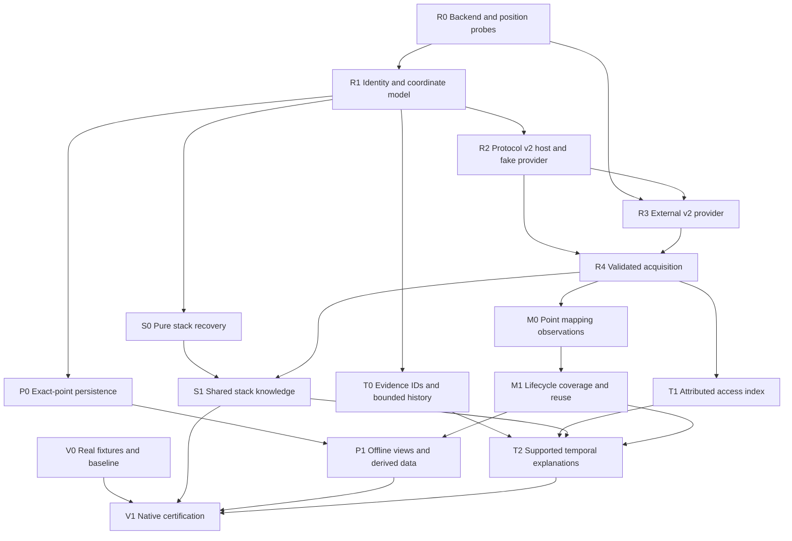

# Timeline completion implementation plan

Date: 2026-09-06

Status: implementation started in bounded host-side increments. Active assignments
and per-subtask completion are tracked in the [task board](2026-09-06-timeline-task-board.md).

Checkpoint: `68d34bdd6d9e9a322210bc44e8ef7c96c10486c3`.

Designs:

- [Completion design](../docs/trace/2026-09-06-timeline-completion-design.md)
- [Proxy v2 handoff](../docs/trace/2026-09-06-proxy-v2-contract-draft.md)

## 1. Delivery rules

- Keep the repository Lean-only with zero Lean package dependencies. External
  Windows proxy work belongs in its own checkout, whose location/owner must be
  established. The historical `.ttfx` loading path stays removed.
- Implement bounded increments below; each has a behavioral acceptance gate and
  an owned file group. Workers must preserve concurrent changes outside their scope.
- Freeze shared model/protocol definitions before parallel dependent edits. The
  integrator owns `Main.lean`, `Session.lean`, shared registration and existing
  monolithic tests; other workers add dedicated test modules.
- Unsupported native capabilities are explicit outcomes. They do not authorize
  invented observations or completion claims for a still-open gap.
- Keep raw evidence and derived results separate. Preserve source/point/thread,
  data origin, coverage, interpretation version and dependency identity.
- Run appropriate Lean checks and affected TLA+ gates at each increment. Native
  and golden gates are separate requirements, with missing prerequisites recorded.
  Do not regenerate references merely to make a diff disappear.

## 2. Workstreams and dependency order

The first useful increment is populated stack knowledge for captures plus a
verified v2 thread-context path. Exact-point persistence and bounded history can
progress without a complete mapping inventory. Certified interval reuse and
stronger cross-position explanations require the additional evidence specified
below. No task may silently substitute a heuristic map for the M1 requirement.

## 3. Suggested ownership for a later implementation run

| Owner role | Exclusive primary scope |
|---|---|
| Model/protocol integrator | `Basic.lean`, `Model/Execution*.lean`, `Model/Capture.lean`, `Trace/Proto.lean`, `Main.lean`, `Session.lean`, shared test registration |
| External proxy worker | Actual Windows proxy/backend checkout and native probe fixtures; no source additions here |
| Acquisition worker | New `Trace/Acquire.lean`, scoped `Trace/Client.lean` updates, dedicated fake-provider tests |
| Stack worker | New `Execution/Stack.lean`, focused `Util/Unwind.lean` and V8/JIT integration, dedicated stack tests |
| Mapping worker | New `Trace/Mapping.lean`, scoped `Trace/Index.lean`/`Jigsaw.lean` changes, mapping tests |
| Persistence worker | New `Trace/Store/` codec/IO modules and dedicated restoration tests |
| Temporal worker | New `Temporal/` evidence/query/explanation modules and dedicated tests |
| Formal/validation worker | Scoped new/updated specs and Lean proof modules, native manifests and test-gate reporting |

The roles below are mapped to actual subagents and queued gates in the task board.
Shared-file changes must go through the integrator, especially coordinate types,
index keys, protocol discriminants, V8/JIT helper signatures and proof dependencies.
Source paths above are relative to `Forensicator/`, except repository-root
`Main.lean`; tests and specifications remain under root `Test/` and `specs/`.

## 4. Prerequisite tasks

### V0 — Restore real fixtures and review the checkpoint

- [ ] Locate/provision `Case` and a Windows trace/runner; record file identities,
  native binary versions, runner details and exact comparison commands.
- [ ] Run the checkpoint against existing golden references. Classify differences
  caused by corrected mapping/context parsing, unclassified-byte scanning and
  evidence-dependent diagnoses. Preserve old references during review.
- [ ] Establish a small reproducible native fixture pack for the scenarios in V1.

Owner: validation worker. Inputs: checkpoint, actual fixture locations and access.
Output: reproducible manifests and comparison report, not a fabricated replacement
for the missing real suite. Completion: every old-gate difference is accounted for
and new references, if needed, are justified individually.

### R0 — Pin backend capabilities and exact observation semantics

- [ ] Obtain the actual proxy checkout, SDK package headers and replay DLL; record
  revisions/hashes. Use the existing header re-pin as history, not a claim that
  sample documentation or an absent running backend has been verified today.
- [ ] Probe raw position widths, invalid-position normalization, first/last points,
  store/exception boundaries, sequence changes and current/non-current threads.
- [ ] Probe registers and replay-target TEB/stack bounds independently. Record the
  actual global cursor position and each thread's reported position.
- [ ] Probe exact memory outcomes, partial reads, range recording provenance,
  missing recording versus unmapped memory, and cancellation/buffer lifetimes.
- [ ] Investigate historical mapping/lifecycle and stable access-ID mechanisms.
  Mark unsupported features explicitly; report what would require recorder changes.

Owner: external proxy worker. Output: capability matrix, pinned ABI report, raw
probe transcripts and independent WinDbg comparisons. Completion: each advertised
capability has a verified API path and reproducible observation. Stop an unsupported
capability without blocking unrelated capabilities. No host-process map may pass
as replay-target metadata.

### R1 — Shared source, coordinate and evidence types

- [ ] Add durable/session-only `SourceId`, attachment epoch and interpretation
  identity; preserve display aliases separately. Define promotion only after a
  verified immutable input manifest binds the current attachment to its content ID.
- [ ] Add the native position pair and lossless legacy conversions after R0.
  Migrate trace-specific APIs, comparison/formatting and interval endpoint types
  in a coordinated change; VA arithmetic remains a separate type/domain.
- [ ] Replace native-position adjacency assumptions with resolved navigation.
  V2 stepping uses a verified provider operation or is explicitly unavailable;
  v1 compatibility must not be advertised as proof of native instruction adjacency.
- [ ] Define resolved point/token, per-thread projection position, register validity,
  byte origin and observation/evidence IDs. Keep event-before context separate from
  the point's after-write context.
- [ ] Update capture adaptation so artifact-backed bytes are distinguished from
  observed process bytes, and source/position/context validity is preserved.

Owner: integrator. Depends on R0 for native ABI/semantics; pure sketches/tests may
precede its completion. Acceptance: copied/renamed sources can agree by verified
identity; same-path replacements differ; stale epochs fail; native high halves
round-trip; unrepresentable v1 conversion fails; valid zero registers stay known.
Update Lean order/endpoint proofs and TLA+ requested/actual-position models.

### R2 — Host protocol v2 and deterministic provider

- [ ] Freeze numeric tags, field order, limits, capability revisions and normal
  error/partial outcomes from the contract draft and R0 evidence.
- [ ] Implement total codecs and byte-pinned vectors for both ends; retain all
  existing v1 bytes and explicit protocol selection. Include bounded v2 inventory
  pages so thread/lifetime/event discovery remains available after the handshake.
- [ ] Add a fake v2 provider supporting capability subsets, partial chunks,
  normalization, stale replies, cancellation and source replacement.

Owner: integrator/protocol worker. Depends on R1 and R0. Acceptance: v1 continues
working; v2 never silently downgrades after generic failures; invalid IDs/lengths/
source tokens are rejected; semantic unsupported responses leave the session usable.

### R3 — External provider implementation

- [ ] Implement v2 selection, manifest/capabilities, exact point resolution and
  copied, owned memory/context responses using the pinned native APIs.
- [ ] Implement only verified thread, stack-bound, mapping and access capabilities.
  Keep native buffer lifetime, thread selection and replay policy explicit.
- [ ] Add the native byte-vector and independent comparison harness.

Owner: external proxy worker. Depends on R0/R2. Acceptance: all advertised fields
match native probes, and no mixed pre/post-instruction point is produced. This task
cannot be certified from this repository's fake provider alone.

### R4 — Validated, budgeted acquisition

- [ ] Route exact reads, contexts, mappings and access windows through one host
  acquisition module with source/epoch/token checks and explicit budgets.
- [ ] Retain completed valid chunks with their coverage; implement tested deadline
  and cancellation behavior. Reconnection starts a new epoch.
- [ ] Preserve cache-only `viewAt`; keep semantic query failure separate from fatal
  transport errors. Prevent background work from moving the user's cursor.

Owner: acquisition worker. Depends on R1/R2; fake-provider work can precede R3.
Acceptance: wrong-point/thread/epoch replies cannot merge; interrupted reads do not
invent zeros or absence; published points survive later requests/cache eviction;
unsupported capabilities do not kill working memory queries. Extend materialization
and acquisition TLA+ models and include deliberate reply-mixing mutations.

## 5. Feature tasks

### S0 — Pure stack recovery over execution inputs

- [ ] Extract the reusable native walk from V8-specific enrichment.
- [ ] Return frames, requested dependencies, stop reason, completeness and evidence.
  Honor per-register validity and exact byte/artifact origins.
- [ ] Preserve partial frames for missing memory/unwind/layout data; keep symbols
  optional. End-of-stack must be established, not inferred from fallback zeros.

Owner: stack worker. Depends on R1; captured-input fixtures allow work before R3.
Files: new `Execution/Stack.lean`, scoped `Util/Unwind.lean`, dedicated tests.
Acceptance: known-zero versus missing registers, native unwind forms, frame-pointer
fallback, cycles, truncation, stack transitions, missing PDBs and unsupported V8
layouts behave correctly. Existing V8/JIT regression cases remain accounted for.

### S1 — Populate and share thread frame knowledge

- [ ] Acquire context/bounds under one resolved observation; drive S0's dependency
  loop with explicit byte/frame/query budgets.
- [ ] Populate `ThreadState.frames` with point/thread/dependency identity. Make V8,
  JIT, `stack` and `inspect` consume the same retained result.
- [ ] Implement instance-aware thread selection and exact-point frame caching;
  invalidate on dependency, architecture, layout or algorithm revision changes.

Owner: stack/acquisition workers; CLI edits by integrator. Depends on R4/S0.
Acceptance: actual proxy stacks work on the pinned Windows fixture; inactive/reused
threads and fiber/stack-growth cases fail or recover with explicit evidence. A
capture's recovered frames become visible in the common point. Missing capability
remains unavailable rather than an empty complete stack.

### M0 — Mapping observations at a point

- [ ] Add typed mapping facts with independent state/protection/type availability.
- [ ] Integrate the provider established by R0, range validation and a mappings
  query view. Preserve byte coverage independently from mapping coverage.
- [ ] Describe the queried domain and distinguish gaps from free regions.

Owner: mapping worker plus external provider worker. Depends on R4/R0.
Acceptance: known committed/reserved/free cases, unknown metadata and protection
changes round-trip with correct provenance. Claim full inventory only after the
provider proves complete coverage and a terminal condition for the declared domain.

### M1 — Lifecycle certificates and safe interval reuse

- [ ] Add allocation/mapping epochs and confirmed lifecycle/continuity windows.
- [ ] Intersect cache validity with write and lifecycle coverage; clip/invalidate
  on decommit/recommit, address reuse, protection changes and gaps.
- [ ] Make strict mode point-only when lifecycle evidence is insufficient. Keep
  any index-only reuse assumption visible and ineligible for certification.

Owner: mapping worker; coordinated index/Jigsaw proof changes. Depends on M0 and
the R0 lifecycle capability. Acceptance: no stale hit across recommit without writes
or identical-value address reuse; incomplete scans cannot establish negative facts.
Update `ReplayApi`/`JigSawSpawner` lifecycle models and mutation controls. If the
backend cannot certify lifecycle coverage, this gap stays open; document the
required recorder instrumentation rather than marking M1 complete heuristically.

### P0 — Exact-observation cache format and atomic save

- [ ] Specify `FTLC` header/chunks/manifest, integrity rules, limits and version
  compatibility. Keep it separate from eager trace ingestion and `.ttfx`.
- [ ] Implement streaming host SHA-256 with standard vectors and independent
  cross-checks; use the external platform implementation for native trace manifests.
- [ ] Persist source-scoped exact observations and their origins/coverage first.
  Implement total decoding and explicit save-generation publication.
- [ ] Verify source manifests and interpretation dependencies before enabling
  restored facts; session-only identities cannot authorize cross-session reuse.

Owner: persistence worker. Depends on R1, with fake sources sufficient initially.
Acceptance: round-trip preserves unknown/absent/known-zero distinctions; truncated,
corrupt, mismatched-source, incompatible-schema and interrupted-save cases cannot
invent usable facts. Test atomic visibility separately from power-loss durability.
Add a cache-generation/restore TLA+ contract and malformed-input guards.

### P1 — Offline sessions and validated derived/interval data

- [ ] Add explicit offline cache loading and bounded storage/eviction policy.
- [ ] Persist/restore derived stacks/findings only with matching dependency and
  algorithm/layout revisions; recompute or leave unknown otherwise.
- [ ] Add interval certificates only when M1 can validate them. Bind a live
  attachment to cached facts only after identity/interpretation verification.

Owner: persistence worker; session integration by integrator. Depends on P0;
certified interval persistence depends on M1. Acceptance: offline missing data stays
unknown; changed files at the same path cannot inherit old facts; cache eviction
cannot corrupt published points; restoration does not promote assumed coverage.

### T0 — Evidence IDs, bounded history and point comparison

- [ ] Use R1's observation IDs; add stable finding/relationship IDs, dependencies
  and coverage without building a second incompatible fact registry.
- [ ] Implement bounded history and comparison over existing events/writes/points.
  Preserve intervening writes even when endpoints match.
- [ ] Return candidates and missing premises explicitly; resolve UI event indices
  to a stable selected occurrence before background acquisition begins.

Owner: temporal worker. Depends on R1; can start on synthetic/v1 histories without
writer attribution. Acceptance: `0 -> 1 -> 0`, ambiguous duplicates, budget stops,
missing intervals and module/address reuse do not lose or overstate evidence.

### T1 — Stable attributed access history

- [ ] Extend the external query/index contract with stable access identity,
  thread instance/IP, event side, optional values and confirmed coverage.
- [ ] Handle speculative/repeated callbacks and paginated/overlapping windows.
  Ambiguous same-position events remain groups when identity cannot be certified.
- [ ] Migrate index dedup/order keys and their Lean proofs together. Add read/
  continuity capability only when independently supported by the backend.

Owner: external proxy + temporal/index workers. Depends on R0/R2/R4.
Acceptance: distinct accesses are not deduplicated by `(pos,va,len)`; repeats do not
duplicate facts; unconfirmed speculative hits do not advance coverage; legacy v1
history remains usable with missing attribution explicit.

### T2 — Explanations with explicit evidence requirements

- [ ] Build a bounded graph of writes, uses, frames, allocation instances and
  exception findings, with observed/supported/candidate relationships.
- [ ] Implement a small initial rule set: confirmed last recorded writer, observed
  value reaching a use, and writer/fault frame context. Add instruction-level
  dependencies incrementally; unsupported forms remain unresolved.
- [ ] Add `explain` output with supporting IDs, alternatives, unmet premises,
  coverage and resumable budgets. Point-analyzer verdicts are inputs, not proofs.

Owner: temporal worker; analyzer/CLI integration by integrator. Depends on T0/T1,
S1 and M1 for the edges that require them. Candidate-only output may ship earlier.
Acceptance: unrelated earlier writes cannot become causes through proximity alone;
gaps and allocation reuse prevent unsupported chains; cross-thread relationships
state the replay-order assumptions and require additional dependency evidence.
Add a temporal-evidence TLA+ contract whose supported edges require all premises,
plus mutations that omit thread/epoch/coverage/value dependencies.

## 6. V1 — Native certification and final integration

- [ ] Run local build/guards, deterministic v1/v2 transport tests, affected TLA+
  gates and their mutation controls against the final integrated revision.
- [ ] Run real-dump goldens and the native trace matrix at pinned versions.
- [ ] Check same-observation registers/memory, stack acquisition, mapping/lifecycle
  claims, persistence restore and explanation trails against independent oracles.
- [ ] Record exact revisions, fixtures, domains/bounds, results and unsupported
  capabilities; update current architecture documentation only for shipped work.

Owner: validation worker/integrator. Depends on the capabilities being certified
and V0. Required fixture matrix:

| Area | Cases |
|---|---|
| Identity/positions | Rename/copy/replacement, native-width codec boundaries, normalization, first/last/sequence boundaries, hard exceptions |
| Threads/stacks | Current/non-current threads, reused TIDs, missing context, valid zeros, stack growth/switch, partial unwind and module reload |
| Memory/lifecycle | Unknown/unrecorded/unmapped, partial reads, reserve/commit/free, protection-only change, recommit without writes, identical-value reuse |
| Access history | Same-position distinct accesses, overlapping windows, speculative/repeated callbacks, gaps and unconfirmed scan endings |
| Persistence | Truncation/corruption, incompatible revisions, interrupted publication, offline gaps and restored results larger than cache capacity |
| Explanations | Equal endpoints with intervening writes, unrelated earlier writes, missing reads, unsupported instruction forms and cross-thread ambiguity |

Large native position values can use byte-pinned synthetic vectors where a short
real trace cannot reach them; report that distinction. No fixture may use the new
implementation as its sole expected-value oracle.

## 7. What closes each gap

| Gap | Closure criterion |
|---|---|
| Thread stacks | Shared frame knowledge is populated from validated capture/proxy inputs and independently checked native cases |
| Full mappings/lifecycles | Complete coverage for the declared domain is demonstrated, including write-free lifecycle changes; otherwise explicitly still open |
| Persistence | Verified reload preserves evidence/coverage and rejects stale sources or incompatible interpretations |
| Temporal inference | Supported relationships satisfy explicit evidence requirements; missing premises remain visible candidates/unresolved results |
| External validation | Real golden and pinned Windows gates pass with intentional differences reviewed and recorded |

Parent gaps remain open until their closure gates pass. The task board records
completed prerequisites separately. The native report now pins the actual SDK ABI
and discovered runner/old trace; current proxy and Case access plus replay-semantic
certification remain open. Host work proceeds through controlled adapters.
