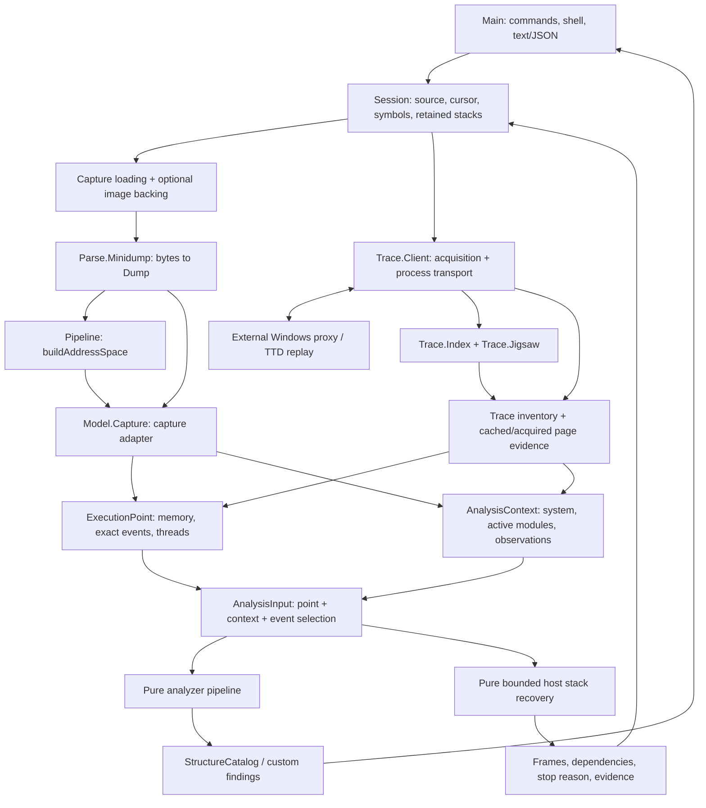

# Forensicator architecture

This document describes the working tree as of **2026-09-06**, including the
execution-point migration and the first timeline-completion increment. It is the
current system overview; older architecture documents retain historical interfaces
and implementation notes. Detailed timeline behavior is described in
[timeline.md](timeline.md).

Forensicator is a Lean 4 application for forensic analysis of Windows x64
minidumps and recorded execution, with particular support for Electron, Chromium
and V8. It parses captured evidence, constructs memory knowledge, recovers
structures and stacks, and produces crash-cause hypotheses with confidence and
provenance. The library and CLI are Lean-only. The Windows replay provider is an
external process, reached through a binary proxy protocol.

## 1. Architectural boundaries

The main abstraction is an **execution point**: memory knowledge, events at that
point, and thread execution/stack knowledge. System information, active modules
and runtime annotations are supplied separately as analysis context. A parsed
`Dump` remains a capture record and enters analysis through an adapter.

Acquisition and inference have separate owners. The session loads sources and
requests missing trace data; pure analyzers consume the resulting `AnalysisInput`.
Reading an existing execution view does not implicitly replay the trace or recover
a stack.



The diagram shows runtime data flow, rather than the exact Lean import graph.
`AnalysisInput` and published execution points are immutable values. The live
proxy's index and page cache are mutable acquisition state.

## 2. Source-tree organization

The [Lake package](../../lakefile.toml) contains the `Forensicator` library and
the `Test` guard-suite library, with CLI and test executables. It has no external
Lean package dependencies: no mathlib, batteries or external parsing library.

| Location | Responsibility |
|---|---|
| [Main.lean](../../Main.lean) | Command parsing, one-shot workflows, shell dispatch, inspection and text/JSON rendering |
| [Session.lean](../../Forensicator/Session.lean) | Loaded source, trace cursor, artifact/symbol loading, explicit acquisition, retained stack results |
| [Basic.lean](../../Forensicator/Basic.lean) | Addresses, legacy trace coordinates and basic shared definitions |
| [Model/ExecutionTypes.lean](../../Forensicator/Model/ExecutionTypes.lean) | Shared system, module, thread, register, memory and provenance records |
| [Model/Dump.lean](../../Forensicator/Model/Dump.lean) | Parsed minidump aggregate, including capture-specific metadata |
| [Model/Execution.lean](../../Forensicator/Model/Execution.lean) | Execution points, knowledge/coverage states and analysis context |
| [Model/Capture.lean](../../Forensicator/Model/Capture.lean) | Adapt a parsed capture to the common execution interface |
| [Model/Trace.lean](../../Forensicator/Model/Trace.lean) | Pure trace records, point construction, event/write queries and lifetime projections |
| [Model/Observation.lean](../../Forensicator/Model/Observation.lean) | New native-coordinate, source/epoch and observation-applicability primitives; live migration pending |
| [Model/Structs.lean](../../Forensicator/Model/Structs.lean) | Inferred structures and confidence-bearing findings |
| [Parse/Minidump.lean](../../Forensicator/Parse/Minidump.lean), [Parse/Cursor.lean](../../Forensicator/Parse/Cursor.lean) | Hand-written, bounded binary decoding |
| [Pipeline.lean](../../Forensicator/Pipeline.lean) | Capture address-space construction and dump-size classification |
| [Spec/AddressSpace.lean](../../Forensicator/Spec/AddressSpace.lean) | Shipping address-space implementation and its invariants/proofs |
| [Analyzer/](../../Forensicator/Analyzer) | Pure inference plugins, shared scanning and registry |
| [Execution/Stack.lean](../../Forensicator/Execution/Stack.lean) | Bounded native stack recovery with explicit evidence and dependencies |
| [Trace/](../../Forensicator/Trace) | Proxy codec, write index, page cache and process client |
| [Util/](../../Forensicator/Util) | Byte/text/JSON helpers, images, PDBs, disassembly, unwind metadata, V8 layouts and SHA-256 |
| [Spec/](../../Forensicator/Spec), [specs/](../../specs) | Lean theorems and TLA+ behavioral contracts |
| [Test/](../../Test), [scripts/](../../scripts) | Guard suite, shell integration, fixture gates and model-checking runners |

`Pipeline.lean` is a small pure construction layer. The end-to-end workflow,
including IO, is coordinated by `Main` and `Session`.

## 3. Evidence and execution models

### Capture versus execution point

`Dump` preserves what the parser learned from a file: system and module records,
threads, memory regions, an optional exception, annotations, mapping records,
V8 heap extensions, anomalies and file size. `Capture.ofDump` exposes this as a
single point whose position is tagged `capture`; it does not invent a TTD
coordinate or thread lifetime.

`ExecutionPoint` contains:

| Field | Meaning |
|---|---|
| `id` | Source key plus a capture tag or trace position |
| `memory` | Known bytes, mapping observations, positive absence and independent coverage |
| `events` | Event payloads occurring exactly at this point |
| `threads` | Thread-instance identity, register/stack-range knowledge, recovered frames and TEB knowledge |
| `eventCoverage`, `threadCoverage` | Whether the corresponding inventory is unknown, incomplete or complete |
| `anomalies` | Recorded inconsistencies or limitations |

A trace thread is identified by its OS ID and, when available, its lifetime
start. Lifetimes use `[start, stop)`, preventing a recycled OS ID from silently
identifying an earlier thread instance.

`AnalysisInput` pairs the point with an `AnalysisContext` and an optional selected
event index. Context accessors enforce scope: active modules require a matching
point identity; system information requires the same source; runtime observations
such as V8 fatal/GC facts require the exact point. Exception-dependent analysis
uses the explicitly selected exception or the sole exception at the point.
Multiple unselected exceptions are ambiguous, and an earlier exception is not
carried forward as though it occurred at the new cursor.

### Memory and knowledge

`AddressSpace` stores sorted, non-overlapping regions and supports address reads
and region lookup. Regions carry memory state, protection and classification
(`Image`, `Stack`, `Private`, `Mapped`, `Other`). Optional on-disk image backing
can supply bytes outside captured regions; it does not establish that a process
mapping was live at the point.

`MemoryState` adds mapping observations and positive absence to that byte store.
Its read result distinguishes `known bytes`, `absent` and `unknown`. A gap in a
sparse capture or cache is unknown. Explicit non-committed mapping evidence or an
observed absent range can establish absence. Known zero bytes remain ordinary
known data. Byte coverage and mapping coverage are separate properties.

Thread registers, stack bounds, TEB addresses and recovered stacks use
`Knowledge α`: `unknown`, `unavailable reason`, or `known value`. An unsupported
provider capability therefore differs from information that has not yet been
acquired. Captured x64 core registers currently require the CONTROL and INTEGER
context groups; per-register validity is still pending.

### Pure trace semantics

`Model.Trace` holds initial memory, writes, events, threads, calls, a frontier and
anomalies. `pointAt` and `analysisAt` project a bounded position into execution
knowledge and supporting context. Events are exact-position occurrences;
`eventsBetween` and `writesBetweenChecked` use checked `(a,b]` intervals. Module
load/unload history determines the active module projection. Conflicting lifetime
or module evidence is excluded with anomalies rather than arbitrarily selected.

The pure byte model folds recorded writes over initial backing. A write record
without payload cannot establish new bytes; point construction invalidates the
affected backing conservatively. The live proxy uses the same execution interface
but obtains page evidence from replay/cache acquisition, not from a fully eager
in-memory write log.

## 4. Minidump execution path

1. `Main`/`Session` reads the file. `Parse.Minidump` validates the header and stream
   directory, then runs per-stream decoders using bounded cursor/byte operations.
2. Decoded facts enter `Dump` with provenance (`streamType`, `fileOffset`, `rva`).
   Unsupported or inconsistent evidence produces errors, missing values or
   anomalies according to the decoder's contract.
3. `Pipeline.buildAddressSpace` folds memory regions through `addRegion`.
   Overlapping or invalid additions are dropped, so earlier accepted regions win.
   `buildAddressSpace_wellFormed` proves that the constructed regions satisfy the
   address-space invariant; it does not prove that every input region was retained.
4. The session may supplement reads with module images found beside the dump.
   `Capture.ofDump` constructs the point and separates system/module/runtime context.
5. Inspection renders the capture or execution view. Analysis loads verified
   symbols when requested, selects plugins, and runs the pure analyzer pipeline.

The `FullMemory`/`StackOnly` label comes from a 64 MiB sum-of-regions heuristic.
It is not a certificate of complete process-memory coverage.

The custom **V8HE** stream contributes cage/isolate information and captured heap
regions. Its v2 extension adds allocation top/limit, GC state/reason and a fatal
message. These remain scoped capture/runtime evidence consumed by V8-aware and
crash-cause analysis.

## 5. Lazy trace execution path

The supported trace entry is `shell --proxy <trace.run>` or
`load --proxy <trace.run>`. Forensicator does not parse `.run` files itself.
The eager `.ttfx` loader and standalone `trace` command are removed; TTFX magic is
explicitly rejected. [ttfx-format.md](ttfx-format.md) is a historical format reference.

### Ownership and transport

`Trace.Client.ProxySession` owns one child process, the frontier and eager
skeleton, mutable `IndexState` and `Jigsaw` references, a fatal-error marker and
the source path. The protocol uses piped stdin/stdout with one outstanding request;
stderr is inherited for diagnostics. A fatal framing/protocol/transport error marks
the attachment unusable.

`FORENSICATOR_PROXY_EXE` selects the provider executable. Local Windows interop is
supported; `FORENSICATOR_PROXY_SSH` instead transports the protocol through SSH,
with the executable path interpreted on the remote host. Native replay and its
SDK behavior belong to that external provider.

The Lean trace modules divide responsibilities as follows:

| Module | Responsibility |
|---|---|
| [Proto.lean](../../Forensicator/Trace/Proto.lean) | Pure request/response framing and byte codec |
| [Index.lean](../../Forensicator/Trace/Index.lean) | Windowed write discovery, per-page horizons, ordering, deduplication and gap anomalies |
| [Jigsaw.lean](../../Forensicator/Trace/Jigsaw.lean) | Pure 4 KiB page cache, validity intervals, observed absence and bounded LRU eviction |
| [Client.lean](../../Forensicator/Trace/Client.lean) | Process lifecycle, request loop, index/page acquisition and execution-view assembly |

Attachment performs the HELLO handshake and obtains threads, events and the
frontier. The live skeleton starts without initial-memory, write or call payload
inventories. Fetched write records accumulate in `IndexState`; they are not copied
into the skeleton's write list. The default cache holds 4,096 pages, or 16 MiB of
page payloads.

### Explicit acquisition

| Operation | Behavior |
|---|---|
| `viewAt t` | Assemble available cache/index/inventory knowledge; no proxy requests |
| `materializeRanges t ranges` | Validate ranges, discover their page-index dependencies and acquire requested pages |
| `prepareAnalysisAt t` | Discover the full write index and prepare pages touched through `t`, retaining already probed evidence |
| `writesBetween` / `writeBytes` | Acquire write-history records or a supported write payload |

Acquisition accumulates each observed page immediately into the returned value.
Later cache eviction cannot remove bytes already included in that result. Batch
preparation remains partial: untouched, unprobed pages are unknown, and inferred
page bytes do not supply missing mapping protections or region classifications.

The cache combines replay reads with indexed write boundaries to determine where
page evidence applies. An unobservable frontier write leaves the affected page
unknown. The next-write fallback must use a write strictly below the frontier;
later bytes cannot be presented as an earlier observation. The current UInt64
frontier/sentinel and page-range arithmetic reject unsupported boundary cases
before wraparound.

Protocol v1 supplies no register contexts, stack bounds, recovered frames, writer
thread IDs or complete mapping inventory. Replay-read truthfulness and sufficient
write/lifecycle coverage remain external assumptions. In particular, a conservative
SDK query policy is confidence-based and does not itself certify exact-point
observations. The [native prerequisite report](../../Drafts/2026-09-06-timeline-native-prerequisites.md)
records the verified ABI facts and outstanding native replay checks.

## 6. Analysis and supporting utilities

The [analyzer contract](../../Forensicator/Analyzer/Analyzer.lean) is:

```lean
run : SymbolsCtx → AnalysisInput → AnalyzerOutput
```

`runPipeline` filters the registered plugins and maps each selected analyzer over
the same input. It collects their outputs into a `StructureCatalog`; plugins do
not mutate the point or implicitly acquire data. `AnalyzerOutput` has typed lists
for recovered structures and a custom JSON field list for plugin-specific results.
Inferred structures carry confidence, and source records retain provenance.

The [default registry](../../Forensicator/Analyzer/Registry.lean) contains nine
plugins, in this order:

| Plugin | Inference |
|---|---|
| `cause` | Crash diagnosis from exception semantics, disassembly, memory and V8/runtime evidence |
| `strings` | Null-terminated ASCII and UTF-16LE strings in known bytes |
| `vtables` | Aligned function-pointer tables in image-region data |
| `lists` | Linked structures recovered by chasing pointers in known memory |
| `arrays` | Pointer targets with regular stride |
| `chunks` | Candidate heap chunks from pointer density in private regions |
| `shapes` | Groups of pointer-bearing nodes with similar structural signatures |
| `v8` | JavaScript stacks recovered through existing native/V8 frame walking |
| `jit` | V8 Code resolution and type feedback for JIT-compiled frames |

Generic strings and pointer inference can use bytes whose region class is unknown.
Class-specific inference still needs its corresponding evidence. Missing exception,
register or runtime context constrains which findings an analyzer can produce.

`Util.Pattern` and `Analyzer.Scan` share pointer filtering/scanning machinery.
`Util.Disasm` implements a native x86-64 subset. `Util.Unwind` handles PE exception
directory/unwind structures; `Image` supplies on-disk module bytes. `Pdb` reads the
MSF-7/PDB information needed for matching and public symbols. Symbol IO lives in
`Main`/`Session`; `SymbolsCtx` supplies an optional publics table bound to the
verified active module base. `V8Layout` and `V8Obj` hold version-specific offsets
and object helpers. None of these mechanisms implies general instruction, unwind
or V8-version coverage.

## 7. Session state and host stack recovery

`Session.Target` is either a parsed dump with its constructed address space and
classification, or a trace skeleton with a cursor. `Session` additionally owns
the source path, symbol configuration, optional live proxy and up to 32 retained
stack recoveries. Opening/reloading a source clears retained recovery knowledge.

`currentIO` returns an existing execution view without acquisition.
`prepareAnalysis` explicitly performs batch preparation for a proxy trace.
`readMemory` acquires a requested range when needed. `recoverThreadStack` invokes
the pure [stack core](../../Forensicator/Execution/Stack.lean) on current knowledge;
it does not automatically fetch the dependencies reported by the walker.

The stack core accepts a point/thread instance and options with frame/read budgets,
verified unwind artifacts and independently established terminal witnesses. Defaults
are 128 frames and 65,536 read bytes. It returns frames, a stop reason, missing
dependencies and the register/read/artifact observations used in recovery.

A valid selected or sole exception context takes precedence for the matching
thread. Unsupported unwind forms, absent/unknown bytes, cycles and exhausted
budgets leave an incomplete result. Without verified unwind artifacts, conservative
frame-pointer recovery can yield partial frames. Complete coverage requires an
exact typed terminal witness supplied by a trusted producer, no outstanding
dependencies and no frame-pointer heuristic. A zero return address is not a root
certificate.

The session reuses a retained result only when its point/thread, effective register
observation, stack bounds, system/modules and observed byte dependencies still
agree. Enrichment creates a new execution value; previously published values remain
unchanged. The shell exposes recovery through `stack <thread-id>` and retained
capture knowledge through `inspect --point`. Ordinary dump inspection keeps its
capture format. V8/JIT analyzers still use their existing walkers; migration to
shared recovered-frame knowledge remains pending.

## 8. Verification and failure behavior

Library code follows total, bounded computation: no `sorry`, `partial` or `panic!`.
Address/range checks commonly lift arithmetic to `Nat` before checking UInt64
bounds. Unknown, unavailable, absent, incomplete and anomalous evidence remain
distinct so that callers can decline unsupported conclusions.

Verification has several complementary layers:

| Layer | Scope |
|---|---|
| Lean theorems | Address-space preservation/uniqueness, capture construction, pure timeline queries, index/cache arithmetic and new observation-scope properties |
| TLA+ contracts | Workflow and knowledge/acquisition behavior under explicitly modeled assumptions |
| Guard suite | Parser, analyzer, execution, proxy-cache, stack, identity and digest regression/property checks |
| Shell integration | Real CLI/session behavior using deterministic capture and stdio-provider fixtures |
| Golden/live gates | Fixture output compatibility and opt-in comparisons against an actual trace provider |

The execution contracts include `Timeline`, `ExecutionState`, `Snapshot`,
`JigSawSpawner`, their regression models, `ObservationScopes` and `StackRecovery`
under [specs/](../../specs). `Snapshot` models partial execution-point acquisition;
the separate `Model` capture aggregate remains part of parsing/workflow specs.
`SnapshotMBT` is a compatibility entry name for the current snapshot contract.

Lean proofs establish the stated properties of the functions they cover. Bounded
Apalache runs check finite instances of the TLA+ models. Neither establishes that
an external replay provider supplies every relevant event, mapping or exact read.
New observation and stack models also retain explicit trusted-producer assumptions.

```sh
export PATH="$HOME/.elan/bin:$PATH"
lake build
.lake/build/bin/forensicator-test
python3 scripts/test-execution-shell.py
python3 scripts/test-stack-shell.py
./scripts/check-timeline-specs.sh
python3 scripts/test-timeline-spec-mutations.py
./scripts/conformance-lean.sh
```

The guard runner is all-or-nothing. The golden gate needs its `Case` fixtures;
native proxy checks additionally require a provider and trace. The latest local
increment recorded 402 passing guards, 10 stack-shell checks, 14 proxy-shell checks
and 12 rejected model mutations. Exact bounds and results are recorded in the
[task board](../../Drafts/2026-09-06-timeline-task-board.md); current real-dump golden
and native replay certification remain open there.

## 9. Implemented boundaries and remaining work

The execution interface, capture adapter, pure timeline queries, explicit v1 proxy
acquisition and capture-side retained stack knowledge are implemented. The
completion work also added two prerequisites:

- `Model.Observation` defines native 64+64 coordinate pairs, identity/epoch/scope
  records and applicability rules with tests and proofs. The live path still uses
  the legacy packed UInt64 coordinate and path-based source identity.
- `Util.Digest` provides total incremental SHA-256 with behavioral verification.
  It does not yet provide a persistent cache, manifest or cross-session restoration.

Remaining integration includes live identity/coordinate migration, v2 contexts and
register validity, verified unwind-artifact/root production, shared V8/JIT stack
consumption, point-specific mapping/lifecycle acquisition, persistence, attributed
access history and causal explanations. ABI probes and pure prerequisites do not
close those runtime gaps.

The [execution timeline design](../trace/2026-09-06-execution-timeline-design.md)
explains the current point/context separation. The
[completion design](../trace/2026-09-06-timeline-completion-design.md),
[v2 protocol draft](../trace/2026-09-06-proxy-v2-contract-draft.md) and
[completion plan](../../Drafts/2026-09-06-timeline-completion-plan.md) describe the
remaining contracts and acceptance gates; the
[task board](../../Drafts/2026-09-06-timeline-task-board.md) records implementation
status and dependencies.
