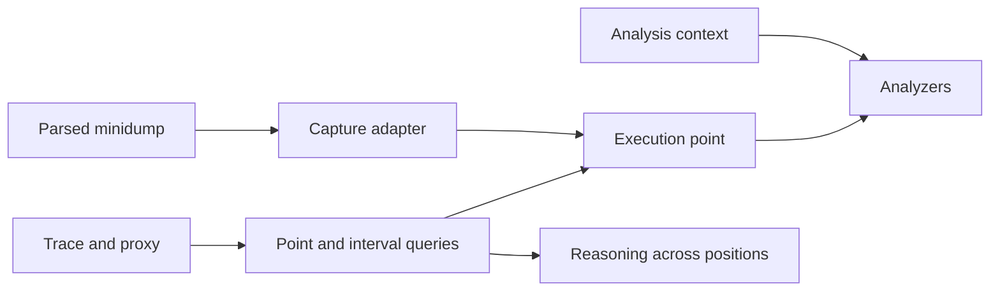

# Execution timeline: positions, evidence, and interval queries

Date: 2026-09-06
Status: implemented locally; verification results and unavailable fixture gates are recorded in the plan
Implementation plan: [Drafts/2026-09-06-execution-timeline-plan.md](../../Drafts/2026-09-06-execution-timeline-plan.md)

## Purpose

Make execution along one ordered timeline easy to investigate. A position exposes
address-space knowledge, events at that position, and thread execution/stack
knowledge. Interval queries expose the changes connecting positions. The core
position abstraction must not contain or construct a `Dump`.

This implements the direction in [docs/timeline.md](../timeline.md). It replaces
the `Timeline -> Dump` analysis interface described by the earlier
[timeline architecture](../arch/timeline.md). The existing proxy transport and
write visibility conventions remain governed by the
[lazy proxy design](2026-08-12-lazy-trace-proxy-design.md), except where the
explicit knowledge contract below requires a less certain answer.

## Current implementation and reason for change

Before this change, `Model/Trace.lean` constructed `Snapshot { dump, space, pos }`.
The previous `Analyzer.run` accepted `SymbolsCtx -> Dump -> AddressSpace -> AnalyzerOutput`.
The previous `ProxySession.snapshotAt` fetched the complete write index and touched pages
before constructing a synthetic dump. That couples execution reasoning to a
capture aggregate, carries the most recent exception into later positions, and
does not populate thread registers.

`Dump` also contains file size, system information, PDB identities, capture
annotations and V8 handler observations. Their lifetimes differ. Replacing its
name with another aggregate containing the same fields would retain the problem.

The previous cache materialization also had this consequence: it fetches all pages
and only then reads the cache. With more pages than cache capacity, earlier pages
can disappear from the returned result. Materialization must accumulate successful
reads as they happen, independently of subsequent cache eviction.

## Vocabulary

| Term | Meaning |
|---|---|
| Source | One loaded trace or one captured minidump; evidence is scoped to it. |
| Position | An ordered TTD coordinate within a trace. Packed-key succession is not a claim about the next replayable instruction. |
| Capture point | The one observation represented by a minidump; it is not assigned a fictitious TTD position. |
| Execution point | A view of memory, exact-position events and thread state at a source-scoped point. |
| Knowledge | What has actually been established about a point; it may be incomplete. |
| Thread instance | Thread ID together with its lifetime occurrence when known. |
| Stack | A thread's stack range and execution context; recovered frames are derived evidence with completeness and confidence. |
| Event | An occurrence at a point, rather than a state carried forward forever. |
| Analysis context | Supporting system/artifact information and position-scoped observations supplied alongside a point. |

## D1: execution points and supporting context

The Lean model uses neutral execution vocabulary outside `Model/Dump.lean`.
The parser continues returning `Dump`. Reusable CPU, exception, module and memory
record types move to `Model/ExecutionTypes.lean`; this is a type extraction, not a
parser change.

The `Model/Execution.lean` interface has the following shape (schematic; the Lean spelling of Partial is `Coverage.incomplete`):

```text
PointId = source key + (Capture | Trace Position)

ExecutionPoint
  id       : PointId
  memory   : MemoryState
  events   : List ExecutionEvent
  threads  : List ThreadState
  anomalies

MemoryState
  space             : AddressSpace
  mappings          : observed mapping metadata, including reserve/free ranges
  mappingCoverage   : Unknown | Partial | Complete
  byteCoverage      : Unknown | Partial | Complete
  absentRanges      : positively established absence

ThreadState
  id, optional lifetime, provenance
  registers         : Knowledge RegisterSet
  stackRange        : Knowledge AddressRange
  frames            : Knowledge RecoveredStack

AnalysisInput
  point             : ExecutionPoint
  context           : AnalysisContext
  selectedEvent     : optional event index
```

`Knowledge A` distinguishes not-yet-known, unavailable-with-reason, and known
values. `RecoveredStack` records frames, completeness, confidence and provenance.
An empty recovered stack is not the representation of an unavailable stack.
No constructor manufactures all-zero registers for lifetime-only threads.

`AnalysisContext` supplies system information, the active module projection and
position-scoped runtime observations. Module descriptions can share immutable
storage; their active projection is resolved at the point being analyzed.
Capture annotations and `V8HeapExt` observations retain an exact `PointId` and
are usable only at that point. This prevents a fatal message, allocation limit,
GC state, cage or isolate observation from leaking to other positions.

The first implementation keeps existing module descriptors as the artifact
catalog vocabulary. A dedicated interned catalog or persistent identity database
is unnecessary for this change. A module load/unload at `p` affects the active
module projection at `p`; same-position events retain record order.

## D2: memory knowledge is independent of memory state

`AddressSpace` remains the pure container used by scanning and decoding. The
surrounding `MemoryState` records facts that its existing `Option` reads cannot
express. A missing region or unreadable byte is unknown unless positive mapping
or absence evidence establishes otherwise. It must not create an uncommitted-
memory, corrupt-code or empty-stack diagnosis by itself.

Raw mapping metadata is retained separately from captured byte regions:
`Dump.memoryInfo` includes reserve/free entries and native protection flags that
are required by the existing cause analyzer. A partial minidump is not labelled
complete merely to preserve an old heuristic.

Disk-image backing stays available to existing dump analysis. It is supplemental
artifact data; its availability does not prove that a process mapping existed or
that its live bytes were unchanged. Proxy-derived page bytes do not invent R/W
protection, Private classification or a complete mapping inventory.

## D3: event and interval semantics

For a trace with frontier `F`:

- `eventsAt(p)` selects records whose position equals `p`.
- `eventsBetween(a,b)` selects records in `(a,b]`.
- `writesBetween(range,a,b)` selects overlapping recorded writes in `(a,b]`.
- Equal interval endpoints return an empty result; reversed or out-of-domain
  endpoints return an explicit error.
- Pure event/write lists retain their order at equal positions. The proxy write
  index preserves its existing `(position,address,length)` ordering and deduplication.
  Protocol v1 has no sequence identity to recover cross-window simultaneous-write
  order, and cannot identify the responsible thread.
- Thread lifetimes use `[start,stop)`; an open lifetime has no stop. An unknown
  lifetime in a minidump does not become an invented trace lifetime.
- Module loads are active at their position; unloads are inactive there. Unknown
  unloads and overlapping active mappings become anomalies.

An exception at `p` remains available through history, but it is not an event at
`p+1`. Cause analysis uses an explicitly selected exception, or the sole exception
at the current point. Multiple unselected exceptions do not silently select the
last one. A minidump's exception belongs to its capture point, with all exception
parameters and register context preserved.

Endpoint comparison cannot replace interval queries. In `x=0 -> x=1 -> x=0`, the
two writes remain available even though the endpoint values are equal. Recorded
order is evidence for causal investigation; it does not itself establish causation.

## D4: lazy views and explicit analysis preparation

Creating a proxy point uses the eager event/thread inventory and currently known
cache entries. It performs no full-index discovery or page fetch. Reading a range
is an explicit two-phase operation: inspect knowledge, fetch dependencies and
bytes, then return a pure result. Unknown, known-absent and unavailable are
observable results rather than fabricated data.

Batch analyzers still need a finite collection of regions. An explicit analysis
preparation operation may discover all pages touched by writes through `p` and
include already probed pages. This is an intentionally partial discovery policy;
untouched, unprobed memory is not proven absent. Targeted range preparation allows
callers to request additional evidence without scanning the full trace.

Materialization accumulates each successful page immediately. Its result owns
those bytes even when the reusable cache is smaller than the requested set.
Index/cache anomalies and positive absence observations are included in the
result. Cache eviction changes cost, not the meaning of a completed request.

Proxy v1 supplies bytes, write metadata, thread lifetimes and module/exception
events. It does not supply registers, stack bounds, recovered frames, writer IDs,
system information or a complete mapping/protection inventory. These capabilities
are reported unavailable. This implementation does not modify or introduce code
for the external Windows proxy.

The proxy uses `min(p+1, frontier)` for write visibility. A write at the frontier
cannot be read after execution. The new knowledge interface must not claim those
bytes as a faithful post-write value. UInt64 maximum would also overflow the
half-open cache sentinel; reject unsupported maximum frontiers rather than wrap.
P3 fallback pages valid only at a later position do not answer the original query.
Free/recommit without writes remains an external index-completeness assumption;
the interface must not upgrade that assumption to verified lifecycle coverage.

## D5: adapters, analyzers and commands



`Model/Capture.lean` adapts a parsed dump plus its supplemented `AddressSpace`
into `AnalysisInput`. Only this adapter and capture-specific presentation need the
aggregate `Dump`. It does not invent prior/future observations or history.

`Analyzer.run` is `SymbolsCtx -> AnalysisInput -> AnalyzerOutput`. General
scanners use `input.point.memory.space` and known thread stack ranges. Cause,
V8 and JIT consume exact events, available execution contexts, active modules and
position-valid runtime facts. Compatibility helpers may expose these individual
facts, but no helper recreates a `Dump` for analysis.

Minidump inspect and artifact matching preserve their capture-facing output.
Trace inspection describes a point and its coverage; matching accepts the active
module projection directly. Symbol selection uses the point's active modules and
selected exception so cursor movement cannot accidentally retain an unrelated
module's symbols. Shell navigation remains cheap; `analyze` explicitly prepares
the partial region set before running the pure analyzers.

## D6: verification and completion criteria

1. The execution point, trace point queries and analyzer interface contain no
   `Dump` aggregate or synthetic-dump conversion.
2. Minidump and proxy adapters both produce the common interface. Capture-only
   fields and observations remain correctly scoped.
3. Exact events, half-open thread lifetimes, stable interval order and rejected
   invalid bounds have behavioral tests. Preserve existing write-fold theorems.
4. Lean theorems cover point identity/bounds and event query membership/partition
   where practical. Existing `snapshot_isSome` proves existence only and must not
   be cited as complete memory, stack or mapping recovery.
5. `Timeline.tla` and `ExecutionState.tla` define the execution-view contract.
   `Snapshot.tla` models immutable partial point materialization, and
   `SnapshotMBT` is a compatibility entry for the same contract. `Model.tla`
   remains capture-specific. Model checking is reported separately from Lean
   compilation; bounded profiles and mutation controls state their coverage.
6. Guard tests exercise unknown versus absent memory, missing registers, current
   exception context, same-base module reuse, position-scoped facts, and results
   larger than the page cache. Existing cause/V8/JIT/symbol checks remain active.
7. Run `lake build`, the complete guard suite and the conformance gate when its
   `Case` fixtures are present. Do not regenerate goldens to conceal a regression.
   Report unavailable fixtures, tools and live proxy coverage explicitly.

## Implementation notes and intentional output changes

The implementation uses `PointId`, `Knowledge`, `Coverage.incomplete`,
`ExecutionPoint`, `AnalysisContext.pointId`, and `AnalysisInput` as described above.
Pure trace entry points are `pointAt`/`analysisAt`/`threadsAt`; proxy entry points
are `viewAt`/`materializeRanges`/`prepareAnalysisAt`. A metadata-only write in the
pure initial-memory model conservatively invalidates an entire overlapping
backing region. The proxy provides finer page-based knowledge.

Four scoped corrections were necessary to preserve the evidence contract:

- Captured threads now retain whether their CONTEXT decoded successfully.
  Missing, truncated and out-of-bounds contexts remain unavailable; a valid
  context whose values are all zero remains known.
- MemoryInfoList decoding now uses native entry offsets and MEM_* constants.
  Invalid layouts/states/ranges produce anomalies and no positive mapping facts.
  AddressSpace receives translated protection bits; memoryInfo retains native
  PAGE_* flags. The layout and state values follow Microsoft's
  [MINIDUMP_MEMORY_INFO specification](https://learn.microsoft.com/en-us/windows/win32/api/minidumpapiset/ns-minidumpapiset-minidump_memory_info)
  and [list header specification](https://learn.microsoft.com/en-us/windows/win32/api/minidumpapiset/ns-minidumpapiset-minidump_memory_info_list).
- Strings and pointer inference now scan known bytes with unknown classification.
  Arrays omit the class-corroboration confidence bonus for `Other`. Heap chunks
  and vtables still require their specific class evidence. Captures with
  unclassified regions may consequently produce additional valid findings, and
  plugin descriptions reflect the expanded scanning scope.
- Cause diagnoses requiring absent/non-executable memory use positive evidence.
  Incomplete event knowledge and ambiguous exception selection lower certainty.
  Earlier unsupported high-confidence verdicts may change. These are intentional
  semantic changes; golden references were not regenerated.

The CLI additionally exposes `events [from to]`, targeted `read <address> <length>`
(up to 65536 bytes per display), and shell `analyze --event <index>`. Trace JSON
inspection reports point coverage and unavailable thread context. A write whose
payload cannot be obtained is labelled `<unavailable>`, without claiming absence.

## Follow-up capabilities

External proxy register/stack retrieval, writer thread IDs, lifecycle watchpoints,
full mapping inventory, persistent knowledge storage and a causal verdict engine
are separate capabilities. The interfaces here make their absence explicit and
allow them to be added without changing what an execution point means.
